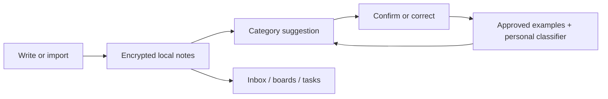

# Note Chat

**Capture a thought like a message. Find it again as a note, idea, or task.**

An Android notebook with a chat inbox, category boards, and a local classifier
that learns from labels you confirm. No account or classification server required.

**[Download Android v1.5.1](https://github.com/TarunB-Git/note-processing/releases/tag/v1.5.1)**
· [Google-free APK](https://github.com/TarunB-Git/note-processing/releases/download/v1.5.1/note-chat-v1.5.1-fdroid-arm64.apk)
· [First five minutes](docs/getting-started.md)
· [Build and contribute](CONTRIBUTING.md)

Android 11+ · ARM64

| Capture in a conversation | Browse by category |
| :---: | :---: |
|  |  |

## A small workflow

1. **Capture:** send “Book the train for Friday.” or share text from another app.
2. **Review:** confirm the suggested category or choose your own.
3. **Find:** return through Inbox, search, category boards, or the To-do list.

Switch between Chat and Notes with the arrows beside Settings. Notes edits
autosave. Private chats stay outside classification; Unsorted holds unapproved notes.

## What you can do

| Need | In the app |
| --- | --- |
| Capture quickly | Text, Markdown, links, images, recordings, and Android sharing |
| Organize your way | Custom categories, confirmed labels, batch reclassification |
| Track actions | To-do checklist, home-screen widget, optional reminders |
| Use existing notes | TXT/Markdown and WhatsApp ZIP import, editable Markdown folder |
| Protect your workspace | Encrypted storage, app lock, private chats, encrypted backups |
| Personalize the app | Chat/Notes layouts, light/dark themes, palettes, launcher icon colors |
| Add optional tools | Local speech transcription, sentence embeddings, translation, OCR |

Search, replies, stars, pins, multiple selection, splitting, and merging support
everyday use. Completed tasks archive after 24 hours; deleted notes remain
recoverable for 90 days.

## How the learning works

Wording cues, hashed word features, approved examples, and a small trainable
classifier suggest categories on your phone. Optional MiniLM adds sentence
embeddings. Confirmations and manual category choices teach it; predictions and
thumbs-down do not. Editing approved text revokes its old training label.

Six distinct approvals per category enable personal-head training. Roughly 20%
of examples are held out and excluded from both fitting and example memory;
new weights are adopted when their macro F1 matches or beats the starter.
MiniLM stays frozen. Results describe the user's labelled sample, rather than
an accuracy guarantee for future notes.

## Engineering worth exploring

| Area | Implementation |
| --- | --- |
| Native Android | Kotlin, Views, RecyclerView; shared records across layouts |
| Personal classification | [524-feature pipeline](android/app/src/main/java/dev/notechat/TextClassifier.kt), approval-based learning, held-out evaluation |
| Local storage | [AES-GCM encryption](android/app/src/main/java/dev/notechat/Vault.kt), Android Keystore, device authentication |
| Editable Markdown | [Stable IDs and three-way reconciliation](android/app/src/main/java/dev/notechat/MarkdownWorkspace.kt), conflict copies, interrupted-write recovery |
| Portable backups | [Encrypted archives](android/app/src/main/java/dev/notechat/BackupArchive.kt) with shared export/restore limits and validation before merging |
| Verification and delivery | 127 JVM/Robolectric tests per Android distribution during v1.5.1 preparation; [CI](.github/workflows/checks.yml), lint, signed APK/AAB releases |

The Google-free distribution excludes Google translation/OCR code and SDKs.
Two clean unsigned free builds from different source directories matched byte
for byte. F-Droid inclusion and independent rebuild verification are separate.

## Data and optional downloads

The built-in classifier works without a model download. Optional MiniLM and
Vosk models enable sentence similarity and local English transcription.
The standard APK includes optional ML Kit translation/OCR: content is processed
locally, while Google receives SDK usage/performance metrics. OCR and language
identification require Google Play services. The Google-free APK omits these tools.

Markdown exports are readable outside app-lock protection. Drive can hold a
chosen backup; it does not provide automatic cloud sync. Android and desktop
use independent workspaces.

## Explore the repository

| Path | Contents |
| --- | --- |
| [Android](android/) | App, classifier, encrypted storage, widget, and tests |
| [Desktop organizer](desktop/README.md) | Python organizer with a local browser interface |
| [Browser showcase](showcase/) | Interactive product demo and static website |
| [Contributor guide](CONTRIBUTING.md) | Build requirements and checks |
| [Original experiment](archive/v1/README.md) | Historical TF-IDF/SVM classifier and report |

[Report a problem](https://github.com/TarunB-Git/note-processing/issues/new?template=bug_report.yml)
· [Release notes](https://github.com/TarunB-Git/note-processing/releases)
· [Apache 2.0](LICENSE) · [Third-party notices](NOTICE)
