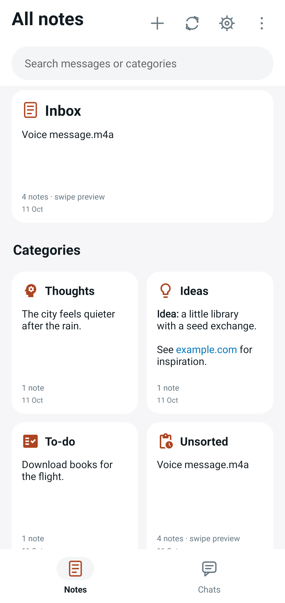
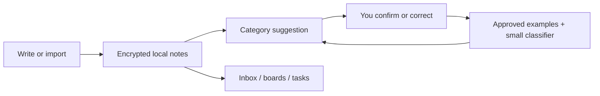

# Note Chat

**Capture a thought like a message. Find it again as a note, idea, or task.**

Note Chat is an Android notebook for people who send notes to themselves. Write
first, review a suggested category, and browse the same notes in a chat inbox or
category boards. The classifier runs on your phone and learns from labels you
confirm. No account or classification server is required.

**[Download Android APK](https://github.com/TarunB-Git/note-processing/releases/download/v1.5.0/note-chat-v1.5.0-arm64.apk)**
· [First five minutes](docs/getting-started.md)
· [Engineering case study](docs/engineering.md)
· [Build and contribute](CONTRIBUTING.md)

| Capture in a conversation | Browse by category |
| :---: | :---: |
|  |  |
| Keep the original order and confirm suggestions. | Open the same records through boards and search. |

**Current stage: preparing a small Android beta.** The published APK is v1.5.0
for ARM64 phones running Android 11 or later. The
[18 October readiness review](docs/release-readiness.md) records two reproduced
backup defects and a native-library compatibility gap in that release. The
1.5.1 candidate fixes those paths. Owner reports phone checks passed on Samsung /
Android 16; the new controls need a short retest and the signed upgrade needs
confirmation. Follow the [release steps](docs/release-next-steps.md). Published builds
and the working checkout can differ;
see the [release notes](https://github.com/TarunB-Git/note-processing/releases).

## A small workflow

1. **Capture:** send “Book the train for Friday.” or share text from another app.
2. **Review:** confirm the suggested category, or choose your own. Confirmations
   teach the classifier; a thumbs-down only tries another suggestion.
3. **Find:** return through Inbox, search, a category board, or the To-do list.

Private chats have their own tab and stay outside classification. Unsorted keeps
notes awaiting your approval, even when they already have a suggested category.

## What you can do

| Need | In the app |
| --- | --- |
| Capture without arranging folders first | Text, Markdown, links, images, recordings, and Android sharing |
| Organize in your own terms | Built-in and custom categories, confirmed labels, batch reclassification |
| Keep track of actions | To-do checklist, home-screen widget, optional reminders |
| Work with existing notes | TXT/Markdown and WhatsApp ZIP import, category export, editable Markdown folder |
| Keep control of local data | Encrypted app storage, optional app lock, private chats, encrypted ZIP export |
| Add tools when useful | Optional local speech transcription, sentence embeddings, translation, and image text extraction |

Search, replies, stars, pins, multiple selection, splitting, and merging support
the everyday note workflow. Completed tasks archive after 24 hours; deleted
notes remain recoverable for 90 days. See the
[usage and data guide](docs/getting-started.md) for limits and recovery behavior.

## How the learning works

The built-in classifier combines wording cues, hashed word features, approved
examples, and a small trainable classification layer. Optional MiniLM adds
sentence embeddings: numerical representations used to compare text meaning.
It does not generate chat replies.

Android keeps the MiniLM encoder frozen. With at least six distinct approvals
per category, it can train a personal classification layer and compare it with
the starter on held-out examples. That comparison excludes held-out text from
training and example memory. It measures the available labelled sample, rather
than guaranteeing accuracy on future notes.

## Engineering worth exploring

| Area | Implementation and evidence |
| --- | --- |
| Android | Kotlin, native Views, RecyclerView, separate message operations and serialization |
| Personal classification | 524 features, balanced softmax training, approval boundaries, stable evaluation split |
| Local storage | AES-GCM snapshots and attachments; Android Keystore protects the data key |
| Editable Markdown | Stable message IDs, three-way reconciliation, conflict copies, interrupted-write recovery |
| Verification | Domain tests, Robolectric UI tests, lint, desktop checks, signed release workflow |
| Honest evaluation | [Dated verification results and unresolved findings](docs/release-readiness.md), separate from historical model scores |

The [engineering case study](docs/engineering.md) explains the tradeoffs and
links to the implementation. The [architecture reference](docs/architecture.md)
describes storage, learning, synchronization, and recovery in more detail.

F-Droid preparation: see [the release plan](docs/fdroid-release.md). The separate free build excludes Google translation/OCR; it has not been submitted.

## Data and optional downloads

The Android classifier works without an extra download. Optional MiniLM and
Vosk model downloads enable sentence similarity and local English transcription.
Optional Google ML Kit translation and OCR process content on-device; Google
receives SDK usage and performance metrics. OCR and language identification
require Google Play services.

Markdown exports and their attachments are readable files outside app-lock
protection. Drive is a destination you choose for a backup, rather than an
automatic sync service. Android and desktop keep independent workspaces.

## Explore the repository

| Path | Start here for |
| --- | --- |
| [Android app](android/) | Screens, classifier, encrypted storage, widget, and tests |
| [Desktop organizer](desktop/README.md) | Python and browser interface; local install and sample commands |
| [Engineering case study](docs/engineering.md) | Design choices, tradeoffs, and code walkthrough |
| [Contributor guide](CONTRIBUTING.md) | Build, checks, release process, and useful contributions |
| [Original experiment](archive/v1/README.md) | Historical TF-IDF/SVM classifier and report; separate from current app accuracy |

Found a problem? [Report a bug](https://github.com/TarunB-Git/note-processing/issues/new?template=bug_report.yml)
with your app version and a small synthetic example. Keep personal notes and
backup passwords out of public reports.

[Apache 2.0 license](LICENSE) · [Third-party notices](NOTICE) · [Known release gaps](docs/release-readiness.md)
